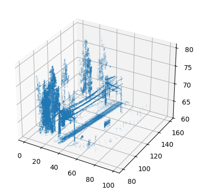
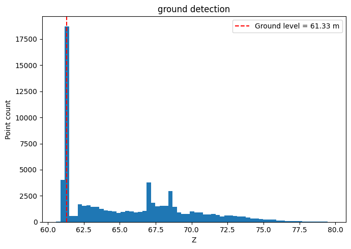
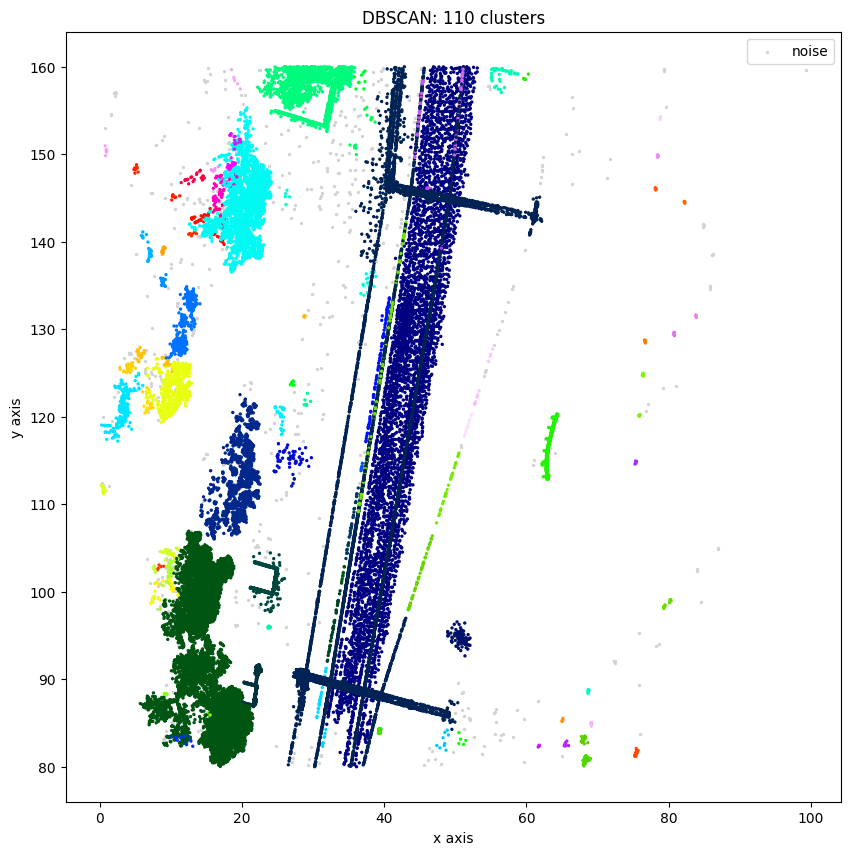
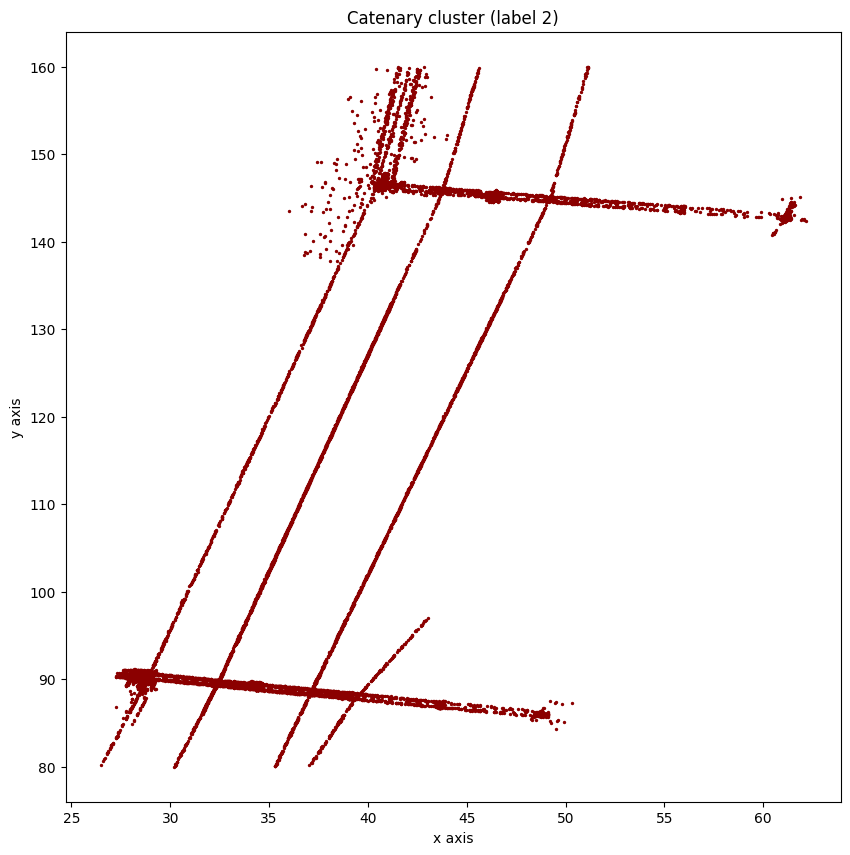

# Dataset 1

## Task 1

**Ground value:** `61.32764843750003`

## Task 2

**Epsilon value:** `0.9399207417966629`

## Task 3

**Catenary cluster label:** `2`

**Bounding values:**
- `min(x) = 26.50`
- `min(y) = 80.02`
- `max(x) = 62.14`
- `max(y) = 159.99`

